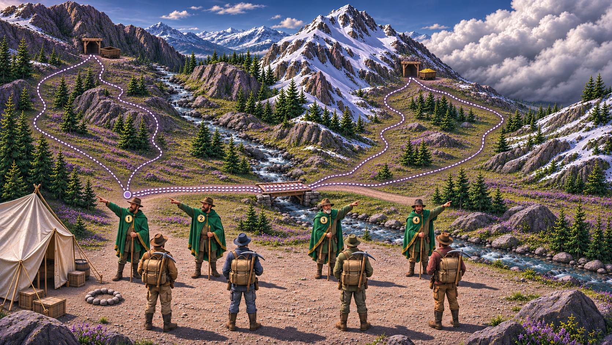
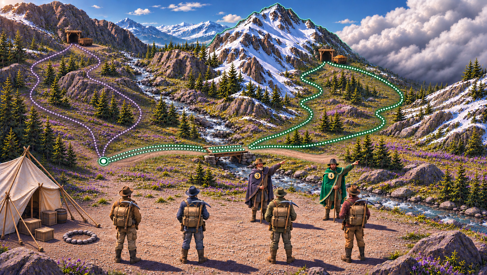
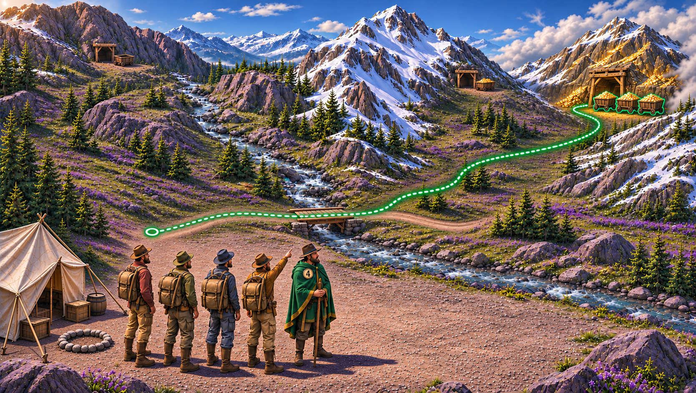
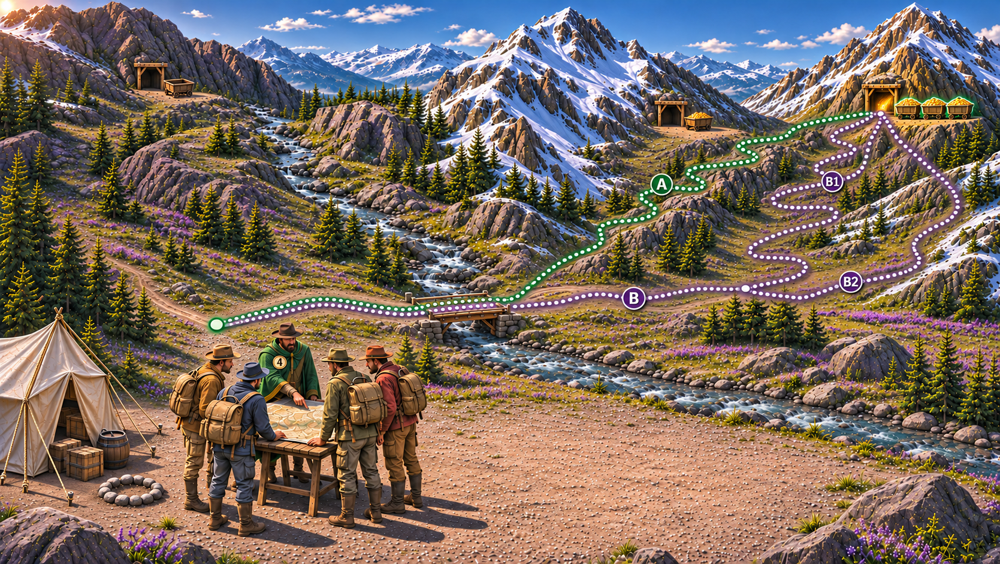

Собственник компании решил сделать в своей компании проект и назначает ответственного топ-менеджера (например, внедрить ИТ-систему). В компании нет человека с опытом внедрения этой ИТ-системы, и топ-менеджер решает найти профильную компанию или специалиста. Находит подрядчика, с которым начинает работать над проектом.

Дальнейшая история (кратко):
Старт проекта. По ходу проекта:
- появляются критические проблемы с качеством, сроками, стоимостью
- выясняется, что проект невозможно завершить по разным причинам
- проект сделали, но оказывается бесполезен или с малым эффектом

Дальнейшая история (подробная):
Топ-менеджер рассказывает подрядчику о цели проекта. Подрядчик предлагает подробнее изучить цели, требования проекта, поговорить с сотрудниками компании, на что топ-менеджер говорит "Да в целом всё понятно, давайте начинать". Если подрядчик соглашается (про ситуации, почему подрядчику нужно подумать об отказе от проекта - будет отдельная публикация), то ситуация может развиться по одному из сценариев:
1. По ходу проекта бюджет выполнен на 100%, а до завершения еще далеко. Клиент приходит к подрядчику. Подрядчик: "Мы выполняли дополнительные запросы сотрудников, и вообще обнаружили много нового. Нужно подписать доп.соглашение на увеличение стоимости работ". Клиент в шоке -> неприятные переговоры -> разрыв договора -> клиент потерял время и (иногда) деньги.
2. По ходу проекта выясняется, что, полностью завершить проект невозможно/сложно/дорого, так как на старте не учли критические требования (например: нужно интегрировать ИТ-систему с другой ИТ-системой, а это сдвиг сроков и увеличение бюджета)
3. При запуске ИТ-системы слабо реализовали какой-либо функционал или было некачественно проведено тестирование функционала. В итоге это либо привело к падению качества продукции (о чем компания может узнать позже), либо к потере контрактов, либо (и такое тоже бывает) работа некоторых подразделений компании "встала". Как итог: потери времени, денег, нервов. Иногда из-за таких инцидентов компании отказываются от внедрения ИТ-системы и откатываются назад, к старой ИТ-системе.
4. ИТ-система запущена, проект завершен. Но спустя какое-то время клиент начинает задаваться вопросом "А зачем мы вообще это делали? Эффект слабый или вообще нет, деньги и время потратили". Клиент будет разочарован проектом и может ничего не сказать подрядчику, а подрядчик будет думать, что успешно реализовал проект.
Сценариев в реальности ещё больше. Если оттолкнуться от тех, что описал выше -> у клиента при наступлении каждого из описанных выше сценариев возникает вопрос к подрядчику: "Почему ты это не предусмотрел? Ты же эксперт! Ты должен был видеть, что что-то не так".
Подрядчик скажет (-> попробует переложить ответственность на клиента): "Вы же сами отказались от моего предложения на старте".
А клиент ему резонно ответит (-> попробует переложить ответственность на подрядчика): "Ты же эксперт! Ты должен был сказать, как надо делать!".
Но в этот момент уже поздно: последствия проваленного проекта будут разгребать оба.

Проиллюстрировать ситуацию можно через метафору "похода старателей к руднику".
Приходят старатели к проводнику и просят провести к горе с золотым рудником.

Если старатель соглашается идти так, как просят старатели, то их всех накроет лавина.

Если группа все же доберется до горы, то может оказаться, что в руднике под горой уже давно нет золота, и весь поход с самого начала был пустой тратой ресурсов.

На примере метафоры найдем ответ на вопрос "Что нужно было сделать по-другому?"
До выхода группы старателей в поход ->
Устроить конкурс среди нескольких проводников и понять, кто из них лучше подходит для похода.

Поговорив с несколькими проводниками, можно обнаружить, что есть разные видения конечной цели и разные варианты путей до этих целей. Благодаря общению с разными проводниками, у старателей появится понимание, с каким проводником они пойдут дальше.

Вместе с проводником ответить на вопрос: к той ли горе идти или нужно немного изменить цель? Выясняется, что есть гора с большим количеством золота.

Вместе с проводником ответить на вопрос: по какому пути идти? Будут ли этапы и резервные пути на случай форс-мажоров?

Всё это мы должны сделать **до** фактического выхода в поход.

Если вернуться от метафоры похода старателей к руднику к бизнесу ->
Всё, что мы делаем до выхода в поход - это предпроектное обследование. Сам поход - это непосредственная реализация проекта.

Что делать собственнику и топ-менеджеру:
1. Провести конкурс среди компаний-подрядчиков.
	1. Запросить у разных подрядчиков их видение работы по проекту. При высокой значимости и стоимости проекта - заплатить за предпроектное обследование, чтобы он почувствовал, что с него по итогу "спросят".
	2. Во время работы над предпроектным обследованием - смотреть на стиль работы каждого подрядчика, как выстраивает коммуникацию, как решает сложные ситуации.
	3. Сравнить итоговое видение проекта у разных подрядчиков (самые важные блоки проекта опишу в следующих публикациях).
2. По совокупности факторов принять решение: делать проект или нет
	1. Если решите не делать проект = это тоже отличный результат, так как вы сэкономите время, деньги и сохраните репутацию.
	2. Если решите делать проект = выбрать подрядчика
3. С выбранным подрядчиком проработать проект:
	1. Определить цель проекта, планируемые эффекты
	2. Ключевые этапы проекта

Ожидаемые эффекты от предпроектного обследования:
1. Вы можете принять решение НЕ делать проект вовсе (по ходу поймете, что проект не нужен/не актуален или обойдется дорого/долго) и направить ресурсы бизнеса на другое.
2. Увеличите вероятность успешной реализации проекта в срок с запланированным бюджетом с необходимым качеством.
3. Получите инструмент, который даст реальную управляемость проектом.
4. Убережет вас от потери денег, срыва сроков и потери репутации перед партнерами.

Из практики: проведение предпроектного обследования дает точность прогноза итогового бюджета проекта +- 8-20%

PS: если какую-либо сторону предпроектного обследования нужно раскрыть шире - пишите. Поделюсь своим опытом и наблюдениями в других публикациях.
